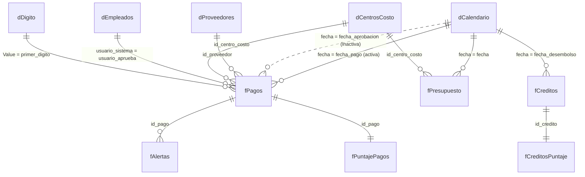

# Práctica 02 · Modelo de datos (esquema estrella)

**Unidad:** U2 · **RA:** RA1 · **Se usa en:** Laboratorio L2 (S2), Taller T2, Avance 1

## Diagrama

## Tablas

| Tabla | Tipo | Granularidad | Clave | Filas aprox. |
|---|---|---|---|---:|
| `fPagos` | Hechos | Un pago | `id_pago` | 6.300 |
| `fPresupuesto` | Hechos | Centro de costo × mes | `id_centro_costo` + `fecha` | 144 |
| `fCreditos` | Hechos | Un crédito | `id_credito` | 3.200 |
| `fAlertas` | Hechos (puente) | Pago × prueba que lo alerta | `id_pago` + `prueba` | ≈ 650 |
| `fPuntajePagos` | Hechos (1:1 con pagos) | Un pago | `id_pago` | 6.300 |
| `fCreditosPuntaje` | Hechos (1:1 con créditos) | Un crédito | `id_credito` | 3.200 |
| `dCalendario` | Dimensión | Un día (2022–2026) | `fecha` | 1.826 |
| `dProveedores` | Dimensión | Un proveedor | `id_proveedor` | 184 |
| `dEmpleados` | Dimensión | Un empleado/usuario | `usuario_sistema` | 60 |
| `dCentrosCosto` | Dimensión | Un centro de costo | `id_centro_costo` | 12 |
| `dDigito` | Dimensión (tabla calculada DAX) | Dígito del 1 al 9 | `Value` | 9 |

## Relaciones y decisiones de diseño

| Relación | Cardinalidad | Dirección | Por qué |
|---|---|---|---|
| `dCalendario[fecha]` → `fPagos[fecha_pago]` | 1:* | Única | Los KPIs de control miden cuándo **sale** el dinero |
| `dCalendario[fecha]` → `fPagos[fecha_aprobacion]` | 1:* | Única, **inactiva** | Se activa con `USERELATIONSHIP` para el análisis por fecha de aprobación |
| `dEmpleados[usuario_sistema]` → `fPagos[usuario_aprueba]` | 1:* | Única | Analizar por aprobador y cargo. El registrador se analiza como columna de texto para no crear ambigüedad |
| `fPagos[id_pago]` → `fAlertas[id_pago]` | 1:* | Única | Los segmentadores de las dimensiones filtran las alertas pasando por `fPagos` |
| `fPagos[id_pago]` → `fPuntajePagos[id_pago]` | 1:1 | Ambas | Tabla de extensión del pago |
| `fCreditos[id_credito]` → `fCreditosPuntaje[id_credito]` | 1:1 | Ambas | Tabla de extensión del crédito (puntaje del modelo) |
| `dCalendario[fecha]` → `fPresupuesto[fecha]` | 1:* | Única | El presupuesto está al primer día de cada mes |

**Configuración obligatoria**
1. Marcar `dCalendario` como **tabla de fechas** (*Herramientas de tabla → Marcar como tabla de fechas*, columna `fecha`).
2. Ordenar `dCalendario[nombre_mes]` por `dCalendario[mes]`.
3. Ocultar las claves foráneas en las tablas de hechos (`id_proveedor`, `id_centro_costo`, etc.) para obligar a filtrar desde las dimensiones.
4. Crear `dDigito` como tabla calculada (ver [`../03_dax/medidas.dax`](../03_dax/medidas.dax)).
5. Ubicar todas las medidas en una tabla vacía `_Medidas`, organizadas en carpetas de visualización.

## Errores frecuentes
- Relacionar `fPagos` con `fCreditos`: son procesos distintos, sin clave común.
- Dejar activa la dirección de filtro "Ambas" en todas las relaciones: genera ambigüedad y resultados incorrectos.
- Usar la jerarquía automática de fechas en lugar de `dCalendario`: rompe la inteligencia de tiempo.
- Calcular KPIs con columnas calculadas en lugar de medidas: no responden a los filtros del usuario.
